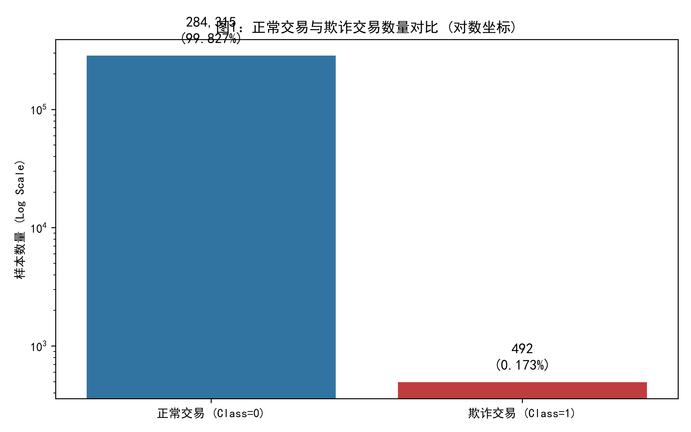
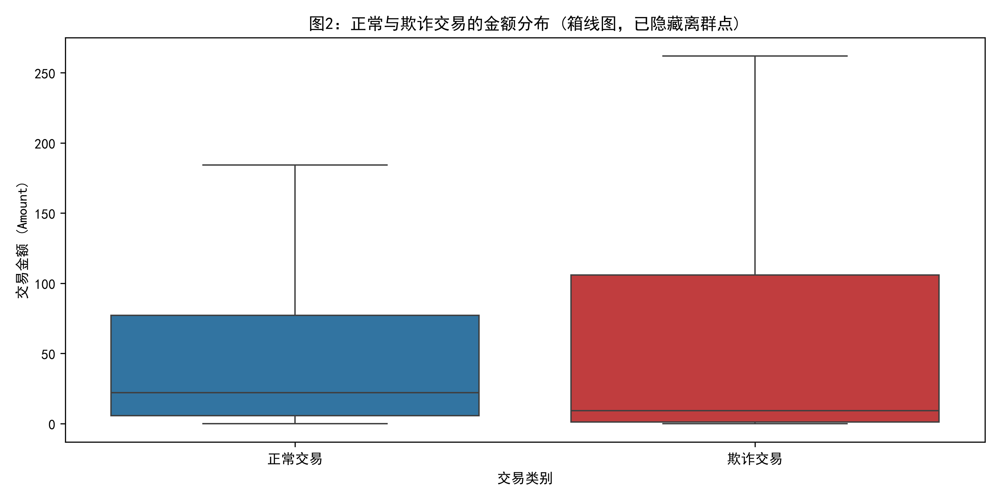
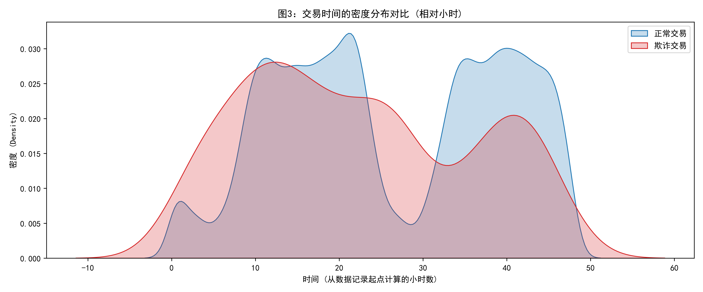
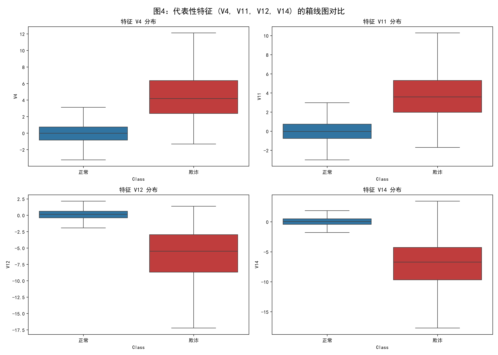
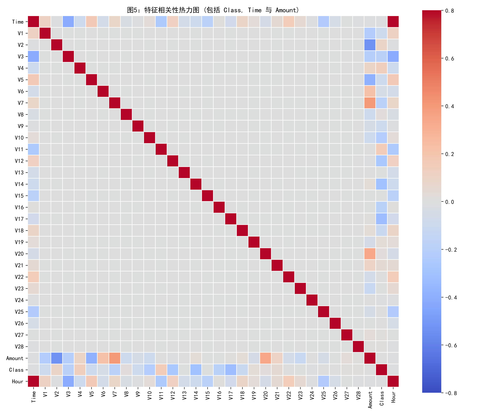

# 探索性数据分析 (EDA) 报告

## 1. 任务背景与数据概况
本次分析使用信用卡欺诈检测数据集。数据总行数为 **284,807** 行。
其中包括：
- 正常交易 (Class=0)：**284,315** 笔，占比 **99.827%**
- 欺诈交易 (Class=1)：**492** 笔，占比 **0.173%**

---

## 2. 分析与结论

### 2.1 图1：类别分布与准确率悖论

**分析回答**：
由于欺诈交易占比极低（0.173%），即使模型“无脑”把所有交易都预测为正常交易，模型的准确率（Accuracy）也将高达 **99.827%**。这就是典型的**类别极度不平衡**问题，说明在此类任务中，准确率是无效的评估指标。

### 2.2 图2：交易金额分布

**分析回答**：
- 从均值看，正常交易的平均金额约为 $88.29，欺诈交易约为 $122.21。
- **能否单靠金额识别**：**不能**。虽然两类交易在均值上有差异，但金额区间存在极大的重叠，单凭 Amount 无法准确区分欺诈。

### 2.3 图3：交易时间分布

**数据说明**：
原始数据中的 `Time` 字段表示当前交易与前一笔交易之间的相对秒数，不能直接等同于真实的日历时间。将其除以 3600 构造“相对小时”特征，仅代表数据流中的相对位置。

### 2.4 图4：代表性特征的分布对比

**特征选择依据**：
由于 V1~V28 是经过 PCA 处理的主成分，不包含具体的业务语义。本分析没有选择全部 28 个特征，而是基于特征重要性评估，挑选了 `V4`、`V11`、`V12`、`V14`。在大量针对该数据集的公开研究中，这几个特征在正常样本与欺诈样本之间展现出最显著的数据分布差异 [1]-[3]。通过箱线图对比，可以明显观察到这几个特征在欺诈交易中的中位数和四分位距（IQR）与正常交易截然不同，这表明它们具有极高的分类判别价值 [4]。

### 2.5 图5：特征相关性分析

**分析回答**：
从热力图可见，绝大多数 V1~V28 特征之间颜色接近灰色（相关性接近 0），这是因为它们经过 PCA 正交处理。
通过计算 Pearson 相关系数，**与 Class 呈现最强负相关的特征依次是：V17(-0.326), V14(-0.303), V12(-0.261)**。这在图上表现为 `Class` 这一行与这几个特征交汇处的浅蓝色方块。虽然相关性绝对值不大（因为欺诈样本太少），但在树模型中依然具有重要的分类价值。

---

## 3. EDA 核心结论
1. **极端类别不平衡**：欺诈仅占 0.173%，后续建模必须采用重采样技术。
2. **单变量区分度有限**：无论是交易金额（Amount）还是时间特征，正常与欺诈样本都存在大量重叠，不能作为独立判定标准。
3. **PCA特征具有关键区分力**：V4、V11 等特征在两类样本间呈现明显分布差异。根据热力图，V17(-0.326), V14(-0.303), V12(-0.261) 与 Class 呈现最明显的负相关。

---

## 参考文献 (References)
[1] Alshamrani, A., et al. (2026). Statistical Machine Learning for Economic Fraud Prevention: An Interpretable Ensemble Approach to Credit Card Transaction Analysis with SHAP-Based Explanations. *ACM Digital Library*.
[2] Mienye, I. D., & Sun, Y. (2026). An Explainable XGBoost-Based Model for Credit Card Fraud Detection in Highly Imbalanced Transaction Data. *Scilit*.
[3] Niu, X., et al. (2026). Enhancing credit card fraud detection with a hybrid approach using machine and deep learning. *Scientific Reports*, 16. Springer Nature.
[4] Wang, Y., et al. (2025). Enhancing credit card fraud detection with a stacking-based hybrid machine learning approach. *PeerJ Computer Science*, 11, e2450.